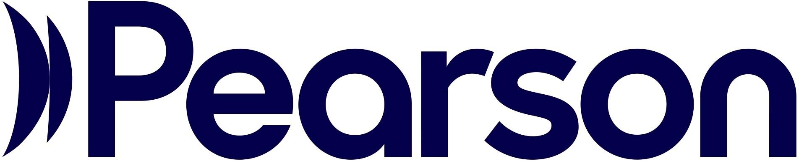
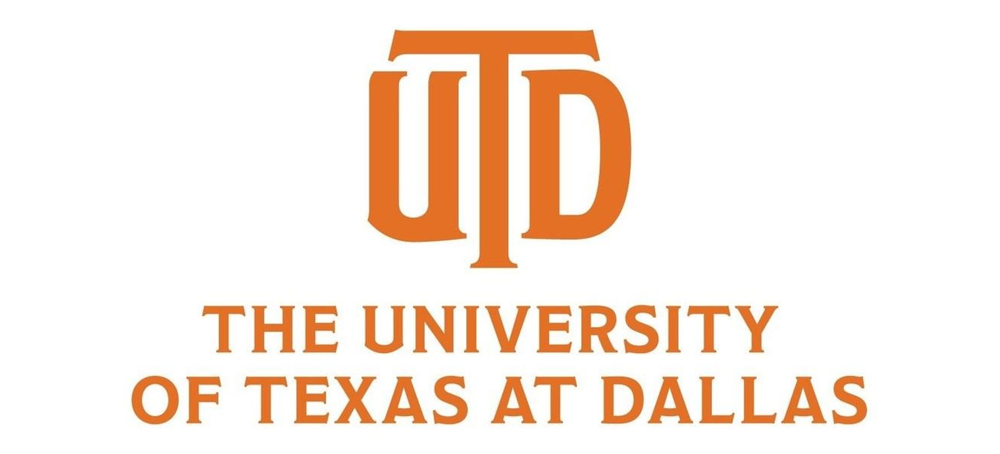

<h1>Hi, I'm Nikhil! 👋</h1>

<h2>Engineering Student at Texas A&M University</a>,  
Aspiring Computer Engineer</a>

<h2>⚙️ Engineering Projects:</h2>

- **Autonomous Systems & Aerospace Engineering (UAS Engineering Design Notebook)**
  - [Autonomous Payload Delivery UAS (RWDC)](https://drive.google.com/file/d/19sy2pwD7jGUPfoc3jR43QuWDPfdulb-H/view?usp=sharing)

- **Artificial Intelligence & Machine Learning (Python PyTorch, Pandas, Keras)**
  - [UTD AI Deep Dive — Gesture Recognition](https://github.com/AdvaithNair07282008/PAAHANA)

- **Robotics Programming and Embedded Systems (Java WPIlib)**
  - [Coyotronics FRC 8816 — Robotics Programming](https://github.com/Coyotronics/YAGSLdriveCode2026)

<h2>💡 Technical Projects & Innovation:</h2>

- **Sustainable Engineering & Innovation**
  - [SkyVault Shingles — Carbon-Capturing Roofing Design](https://youtu.be/G241m7uNrEw?si=lbAgm8zlxBqCX1IW)

- **Software Development & Project Leadership (UE Game Engine, C++ Scripting)**
  - [Unreal Engine Game — Scrum Master & Lead Developer](https://canva.link/f5d5cebjy4950rf)

## 🏆 Certifications

<table>
  <tr>
    <td align="center" width="50%" valign="middle">
      

        
      

       
      <strong>IT Specialist – Java</strong>
       
      Pearson Education
        
      <a href="https://www.credly.com/badges/1809d068-a3e3-4a6d-8f67-7fedcf3b8f7b/public_url">View Verified Credential ↗</a>
    </td>
    <td align="center" width="50%" valign="middle">
      
        
      <strong>AI Research Internship</strong>
       
      University of Texas at Dallas
        
      <a href="images/utd-ai-certificate.png">View Certificate ↗</a>
    </td>
  </tr>
</table>

<h2 style="color: #6A5ACD;">🤝 Connect with me:</h2>

 
 
